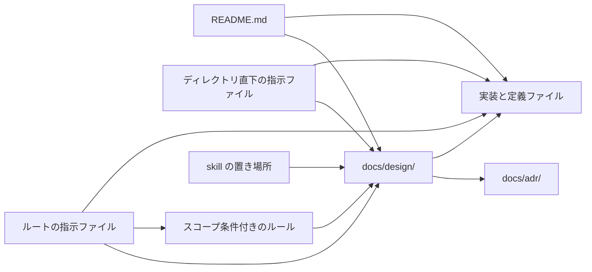

# 文書の配置

## 層と役割

- README.md: 人間の入口。目的、ディレクトリの地図、代表的なコマンド。
  値、手順、エージェント向けの指示は置かない
- ルートの指示ファイル (Claude Code は CLAUDE.md、Codex は AGENTS.md): エージェント向けのルーティングと、
  環境固有で推論できない落とし穴。ファイルを読めば分かることは書かない
- ディレクトリ直下の指示ファイル (Claude Code は CLAUDE.md、Codex は AGENTS.md): そのディレクトリのファイルを
  触るときだけ必要な規約。
  読み込まれる時機はエージェントによる。Claude Code では起動時には読まれず、そのディレクトリのファイルを
  読んだときに読み込まれる。Codex は起動時に、リポジトリのルートから作業ディレクトリまでの指示ファイルだけを
  読み込む。ルートで起動して下のディレクトリを触るときは、触る前に、ルートから対象のディレクトリまでの経路にある
  未読の指示ファイルを上位から順にすべて読む。対象のディレクトリの指示ファイルだけでは、中間のディレクトリの規約が抜ける
- ディレクトリ直下の README.md: その構成物を人間が操作する手順。セットアップ、
  実行例、エラーパターン、ロールバック
- docs/design/: 意図、不変条件、境界、契約、理由。1 ファイル 1 ドメイン。
  値、手順、コード例は置かない
- docs/adr/: 決定と却下案。書く、更新するときは [adr.md](adr.md) を読む
- docs/reports/: 調査メモや計画を、判断や手順が固まるまで置く作業台。ファイル名に日付と主題を含める
  (`YYYY-MM-DD-{topic}.md`)
  - 中身の行き先が決まったら「層と役割」に従って移し、ファイルを消す。主な行き先は、決定なら docs/adr/、
    意図と理由なら docs/design/、値ならコードと設定、操作の手順とエラーパターンならディレクトリ直下の
    README.md、繰り返す 3 ステップ以上の手順なら skill の置き場所
  - 消す前に参照元を直す。参照元が ADR のときは [adr.md](adr.md) を読み、編集を許す範囲でだけ直す。
    直せないリンクは残してよい
- docs/tmp/: 使い捨てのスクリプトと出力、別のリポジトリに渡すための書き出し。コミットしない
- スコープ条件付きのルール (Claude Code は `.claude/rules/`): ファイル拡張子やファイル名 prefix のように、
  ディレクトリ単位で表せないスコープ条件が要るルールだけ
  - 本文は `.claude/rules/` の 1 ファイルに置き、正本はそれだけにする。paths frontmatter を付ける。
    Claude Code は対象のファイルを扱うときにこれを読み込む。paths の無いファイルは、Claude Code では
    起動時に無条件でロードされる
  - paths で読み分ける仕組みの無いエージェント (Codex など) のために、ルートの指示ファイルに
    「この条件のファイルを扱うときは、このファイルを読む」という 1 行の案内を置く。案内には条件とパスだけを
    書き、ルールの中身を写さない
- skill の置き場所 (Claude Code は `.claude/skills/`、Codex は `.agents/skills/`): 3 ステップ以上の手順。
  SKILL.md は概要と目次にし、詳細は references/ へ 1 段だけ下げる。SKILL.md は 500 行以下
- コードと設定: 値そのもの。コメントにはその値である理由だけを書く
- コミットメッセージと PR: 変更履歴、移行の経緯、issue 番号への参照

## 正本

- 値、名前、パス、書式は、機械可読な正本を実装側に 1 つ置く。lint のルール、
  script の定数、CI の workflow がこれにあたる
- コードの定数で自然に表せない語彙は、実装側に定義ファイルを置いて lint に読ませ、
  正本にする
- 文書は正本を持たず、正本の場所へリンクする
- 同じ値を 2 か所に書かない

## 参照の向き

逆向きのリンクは張らない。README.md とルートの指示ファイルの相互リンクも張らない。
スコープ条件付きのルールへの案内はルートの指示ファイルにだけ置き、ディレクトリ直下の指示ファイルには置かない。

## 実装への参照

- コードを参考例として引用せず、実装へリンクする
- docs/design/ から実装へのリンクは、正本の所在を示すためだけに使う
